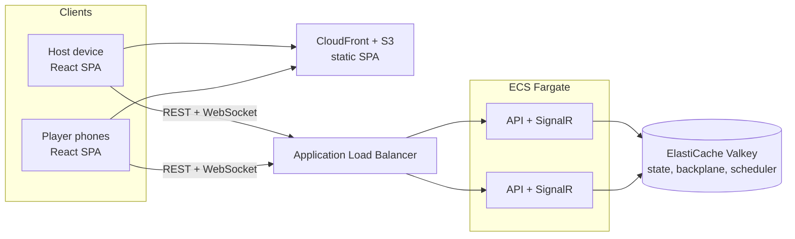

# SyncBingo

**A real-time, session-based multiplayer Bingo platform.**

[Design docs](docs/README.md) · [Architecture decisions](docs/adr/README.md) · [Roadmap](docs/09-roadmap.md) · Live demo: *coming in Phase 3*

> **Status:** design complete, implementation starting (Phase 0). The [design documents](docs/README.md) are the source of truth; this README describes the planned system.

## What is SyncBingo?

Nobody brings bingo cards and balls to a family party, but everyone has a phone. SyncBingo is a web app, drop-in-style party game for Bingo: one person hosts, everyone else joins from their own phone, and the app deals the cards, calls the numbers and keeps track of the winners. It works for a family gathering with small children, a classroom, a virtual happy hour or a room of adults who want to play seriously.

There are no accounts, no downloads and no personal data. A session lives only as long as the game, then it is gone.

### Key features

- **Easy to join.** Players scan a QR code or type the game code, enter the host's game password, pick a name and they're in. Players can join between rounds.
- **Live, synchronised calls.** When a ball is drawn, it reaches every phone at once. The host chooses automatic calling on a timer, or calls each ball aloud.
- **Digital cards.** Standard 75-ball cards that fit a small phone screen without scrolling. Players mark their own squares; careless marking can cost you, unless the host limits marking to called numbers for young children.
- **Many ways to win.** Normal Bingo (row, column or diagonal), Four Corners, the letters **B I N G O**, and Blackout. The host can switch mid-round, say from Normal to Blackout, without clearing the cards.
- **The host is in charge.** Pause for a prize, start a new round, inspect a card, award a win, show the leaderboard.
- **Kid mode or serious mode.** Settings such as marking only called numbers, limits on unmarking, an always-available Undo, auto-fill for missed numbers (each player opts in), highlighting matching squares, win celebrations and automatic win detection make it forgiving for small children; turn them off for adults who want to pay attention.
- **Drop-out proof.** A phone that goes to sleep reconnects with the same name, card and marks.

## Technical highlights

- **Server-authoritative game state.** Clients send intents (mark square, claim Bingo); the server validates every one and broadcasts the result.
- **REST for commands, SignalR for events.** Commands are plain HTTP endpoints described in OpenAPI. A WebSocket-only SignalR hub pushes events through a Redis backplane, so any API instance can reach any player. Events carry sequence numbers, and a snapshot endpoint lets a client rebuild its state after a gap.
- **Rules as data.** A card's marks are a 25-bit mask, a win pattern is a list of masks, and a win is `(marks & mask) == mask`. Letter shapes, Four Corners and Blackout are configuration, not code.
- **Ephemeral Redis state.** All session data lives in Redis with a TTL. Shared mutations take a short per-session lock; marks only touch the player's own hash field, saved with a versioned compare-and-set, so 100 players tapping at once don't contend with the host and a draw's auto-fill never overwrites a tap.
- **Leaderless auto-calling.** A Redis sorted set plus an atomic Lua claim with a lease means exactly one instance draws each ball, even across multiple containers, and a crashed instance hands over automatically.
- **Security without accounts.** 16-character game codes from a CSPRNG, hashed passwords and session tokens, rate-limited joins, and a player only ever receives their own card.
- **Infrastructure as code, two profiles.** AWS CDK in C# defines the full design (ECS Fargate on arm64, ElastiCache Valkey, S3 + CloudFront, ACM) and a lean one, a single small instance running the same containers, which is what runs the live site cheaply ([cost and hosting](docs/10-cost-and-hosting.md)). GitHub Actions deploys using OIDC, with no long-lived keys.

## Architecture



This is the full reference design. The live site at syncbingo.com runs the same containers on one small instance (Caddy, the API and Valkey), and locally the same shape runs in Docker Compose as `web`, `api` and `valkey`. More detail is in [02 — Architecture](docs/02-architecture.md) and [10 — Cost and hosting](docs/10-cost-and-hosting.md).

## Tech stack

| Area | Choices |
|------|---------|
| Backend | C# / .NET 10, ASP.NET Core minimal APIs, SignalR |
| Frontend | React 19, TypeScript (strict), Vite, React Router, Zustand, Tailwind CSS |
| State | Redis (ephemeral, TTL); no relational database |
| Local and test | Docker Compose, Testcontainers |
| Cloud | AWS, provisioned with AWS CDK in C#: Lean (one instance: Caddy, API, Valkey) for the live site; Full (ECS Fargate arm64, ElastiCache Valkey, S3 + CloudFront, ACM) for the reference design. Domain and DNS on Cloudflare |
| CI/CD | GitHub Actions with OIDC |

## Project layout

```
src/SyncBingo.Domain/          pure C#, no I/O
src/SyncBingo.Application/     commands, handlers, ports
src/SyncBingo.Infrastructure/  Redis store, scheduler, hashing
src/SyncBingo.Api/             endpoints, SignalR hub, auth
tests/                         unit and integration tests
web/                           React + TypeScript SPA
infra/                         AWS CDK (C#)
docs/                          design documents and ADRs
```

## Run it locally

Build and test the backend (requires the [.NET 10 SDK](https://dotnet.microsoft.com/download), plus Docker or Podman for the integration tests, which start a real Valkey with Testcontainers):

```bash
dotnet build
dotnet test
```

Run and test the web app (requires [Node.js](https://nodejs.org/) 24 or later). In development the app proxies `/api` and `/hubs` to the API on port 5080, so start that first (`docker compose up api valkey`):

```bash
cd web
npm install
npm run dev            # http://localhost:5173
npm run lint
npm test
npm run api:generate   # after changing the API: regenerates the OpenAPI document and the typed client
```

The web app's API types are generated from the API's own OpenAPI description, and CI fails if either is out of date, so the client can't drift from the server.

Run the full stack in containers (web, api and valkey):

```bash
docker compose up --build         # then open http://localhost:8080
```

Planned: `docker compose --profile dev up` for hot reload, and `docker compose run --rm tests` for the Playwright end-to-end tests.

Podman works too; see [07 — Infrastructure](docs/07-infrastructure.md).

## Testing

| Level | Tooling | Focus |
|-------|---------|-------|
| Domain unit | xUnit, Shouldly, FsCheck | Card generation, win patterns, state machine, game codes |
| Application | xUnit with fakes | Command handlers, authorisation, events |
| Integration | WebApplicationFactory + Testcontainers (Redis) | Redis store atomicity and expiry, endpoints, auth, rate limits, scheduler, concurrency |
| Real-time | SignalR .NET client | Event delivery, audiences, reconnect and resync |
| Frontend unit | Vitest + Testing Library | Components, hooks, store |
| End-to-end | Playwright | Host and several players through full games, mobile viewports |
| Load | k6 | 100 players per session, draw fan-out latency |

The full strategy is in [08 — Testing strategy](docs/08-testing-strategy.md).

## Architecture decision records

| ADR | Decision |
|-----|----------|
| [0001](docs/adr/0001-server-authoritative-state.md) | Server-authoritative game state |
| [0002](docs/adr/0002-rest-commands-signalr-events.md) | REST for commands, SignalR for events |
| [0003](docs/adr/0003-redis-ephemeral-state.md) | Redis with TTL, no relational database |
| [0004](docs/adr/0004-rules-as-data-bitmasks.md) | Variants and win patterns as data (bitmasks) |
| [0005](docs/adr/0005-session-tokens-no-accounts.md) | Session tokens, no accounts |
| [0006](docs/adr/0006-game-code-format.md) | Game code format |
| [0007](docs/adr/0007-fargate-and-cdk-csharp.md) | ECS Fargate hosting, AWS CDK in C# |
| [0008](docs/adr/0008-host-credited-wins.md) | Host credits wins |
| [0009](docs/adr/0009-callable-items-and-faces.md) | Callable items with call and card faces (proposed) |
| [0010](docs/adr/0010-display-pairing-with-short-codes.md) | Pairing display screens with a short code |

## Roadmap

0. **Foundations:** solution layout, Docker Compose, CI, domain model with tests
1. **Core game (MVP):** sessions, joining, calling, marking, win conditions, rounds, leaderboard
2. **Polish and hardening:** accessibility, rate limiting, Playwright and k6 suites
3. **AWS deployment:** CDK stacks, OIDC pipeline, dashboards, live demo
4. **Future:** "Serious Bingo" (multiple cards per player), custom variants, waiting room

Details are in [09 — Roadmap](docs/09-roadmap.md).

## License

Source-available for portfolio review and evaluation only; see [LICENSE](LICENSE). Hosting or monetising this software requires written permission.
