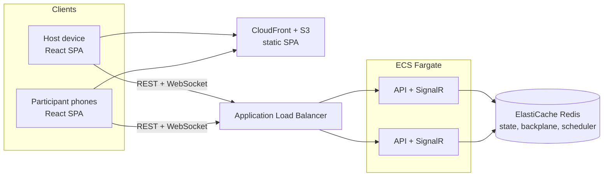
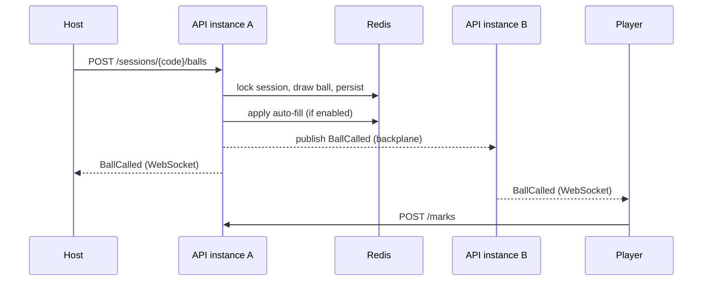

# 02 — Architecture

## 1. System context



Locally, the same shape runs in Docker Compose: `web`, `api`, `redis`.

## 2. Design decisions at a glance

| Concern | Decision | ADR |
|---------|----------|-----|
| Source of truth | Server-authoritative game state | 0001 |
| Transport | REST for commands, SignalR for server→client events | 0002 |
| Persistence | Redis with TTL; no relational database | 0003 |
| Rules | Variants and win patterns as data (bitmasks) | 0004 |
| Identity | No accounts; opaque session tokens | 0005 |
| Game code | 16 chars, ambiguity-free alphabet, CSPRNG | 0006 |
| Hosting/IaC | ECS Fargate, AWS CDK in C# | 0007 |
| Wins | Host-credited | 0008 |

## 3. Backend

### 3.1 Solution layout

Target framework: **.NET 10** (LTS). The SDK version is pinned in `global.json`.

```
SyncBingo/
├─ src/
│  ├─ SyncBingo.Domain/           # pure C#: no I/O, no framework deps
│  ├─ SyncBingo.Application/      # commands, handlers, ports (interfaces)
│  ├─ SyncBingo.Infrastructure/   # Redis store, scheduler, token/password hashing
│  └─ SyncBingo.Api/              # ASP.NET Core: endpoints, SignalR hub, auth, DI
├─ tests/
│  ├─ SyncBingo.Domain.Tests/
│  ├─ SyncBingo.Application.Tests/
│  └─ SyncBingo.Api.IntegrationTests/    # Testcontainers (Redis) + WebApplicationFactory
├─ web/                            # React + TypeScript (Vite)
├─ infra/                          # AWS CDK (C#)
├─ docs/
└─ docker-compose.yml
```

### 3.2 Layers

- **Domain** — `Session`, `Round`, `Participant`, `Card`, `ICardGenerator`, `BingoVariant`, `WinPattern`, `WinCondition`, game-code generator, state machine rules. Deterministic and trivially unit-testable (random source injected).
- **Application** — one handler per command (`CreateSession`, `JoinSession`, `MarkSquare`, `DrawBall`, `StartRound`, …). Each handler: load → authorise → apply domain rule → persist → publish events. Ports: `ISessionStore`, `IEventPublisher`, `IClock`, `IRandom`, `ITokenService`, `IPasswordHasher`.
- **Infrastructure** — `RedisSessionStore`, `RedisCallScheduler`, hashing, TTL policy.
- **Api** — minimal API endpoints (REST commands), `GameHub` (SignalR, server→client only), authentication handler for session tokens, rate limiting, ProblemDetails, health checks, OpenAPI.

### 3.3 Cross-cutting

Structured logging (Serilog → CloudWatch), correlation IDs, ASP.NET Core rate limiter (join attempts keyed by code + IP), health endpoints (`/healthz`, `/readyz` incl. Redis), OpenAPI document published from CI.

## 4. Real-time design

- Commands travel over **REST** (easy to test, idempotent, clear HTTP semantics). The **SignalR hub only pushes**: it keeps open connections and fans out events.
- Each connection authenticates with its session token and joins SignalR groups `s:{code}` (everyone) and `s:{code}:host` (host only).
- **Redis backplane** lets any API instance publish to connections held by another instance.
- Every pushed event carries a monotonically increasing `seq`. A client that detects a gap, or reconnects, calls `GET /sessions/{code}/snapshot` and rebuilds state. Events are hints; the snapshot is truth.
- Clients use WebSockets only (`skipNegotiation`), which avoids sticky-session requirements behind the ALB.



## 5. Auto-call scheduling

Auto mode needs exactly one instance to draw per tick, without a leader.

- Redis sorted set `bingo:schedule` — member = session code, score = next due time (ms).
- Every instance runs a `BackgroundService` polling every ~500 ms. A Lua script **claims** due sessions atomically by moving their score to `now + lease` and returning them.
- The claiming instance takes the session lock, draws, then re-schedules at `now + interval`.
- If an instance dies mid-claim, the lease expires and another instance picks the session up. No ball is lost; at worst one draw is delayed by the lease.
- Pause removes the session from the schedule; resume re-adds it with a fresh interval.

## 6. Concurrency and consistency

- Mutations that change shared session state (draw, pause, start/end round, settings, win condition) run under a **short per-session Redis lock** and bump a session `version`.
- Participant-only mutations (marks, redraw) touch just that participant's hash field, so 100 players tapping do not contend with the host.
- Name uniqueness uses `HSETNX` on a normalised-name index, so two simultaneous joins with the same name cannot both succeed.
- Card uniqueness (FR-39) works the same way: dealing a card `SADD`s its fingerprint to the session's `cards` set and redeals if the fingerprint was already there, so concurrent joins or redraws never end up with identical cards.
- Auto-fill is applied by the server at draw time, inside the draw's critical section, so a fill and the ball that triggers it are consistent.

## 7. Frontend

React 19 + TypeScript (strict), Vite, React Router, Zustand for session state, Tailwind CSS, `@microsoft/signalr`, `qrcode` for client-side QR rendering.

```
web/src/
├─ app/            # router, providers, layout (incl. AdSlot grid)
├─ features/
│  ├─ landing/
│  ├─ host/        # create, console, settings, leaderboard
│  ├─ join/        # code + password, name entry
│  └─ play/        # card, ball display, bingo button, win overlay
├─ api/            # typed REST client generated from OpenAPI
├─ realtime/       # SignalR connection, reconnect + snapshot resync
├─ domain/         # shared types, pattern previews
└─ components/     # Card, Ball, AdSlot, Button, Toggle, ...
```

Routes: `/`, `/host/new`, `/host/:code`, `/join` (manual), `/join/:code` (QR target), `/play/:code`.

State rules: server state lives in the store, rebuilt from the snapshot; optimistic UI only for marking, reconciled by the next event.

## 7a. Security notes

- Game password and session tokens are hashed at rest (PBKDF2 or Argon2 for the password; SHA-256 of a 256-bit random token for session tokens).
- Join attempts are rate-limited per code and per IP to blunt guessing.
- Participants only ever receive their own card; host card inspection is host-only.
- All inputs validated server-side (name length and allowed characters, cell index, state preconditions).
- **Untrusted text is data, never code.** Names (and, later, custom content) are the only free text players send, and they are never spliced into anything that gets interpreted:
  - *Storage:* there is no SQL database. Redis commands send every value as a separate argument, and Lua scripts receive values through `ARGV`, never by building script text. Redis **key names** are built only from validated game codes and server-generated ids, never from a name.
  - *Browser:* React renders names as text. `dangerouslySetInnerHTML` is banned by an ESLint rule. A Content-Security-Policy header on the site (nginx locally, CloudFront in AWS) is planned for the Phase 2 hardening pass.
  - *Logs:* structured logging records names as properties. Line breaks are collapsed to spaces during name validation, so a name cannot forge log lines.
  - *Exports (future):* any CSV or spreadsheet export must escape values starting with `=`, `+`, `-` or `@` so a name cannot run as a formula.
  - Name validation (`docs/04` §5) is a second layer on top of this: injection syntax such as `'); DROP TABLE x;--` is already refused by the character rules, while harmless words like "DROP TABLE" are allowed.

## 8. Observability

Logs: Serilog JSON → CloudWatch. Metrics: active sessions, connected clients, draws/sec, join failures. Optional OpenTelemetry traces. Alarms on Redis memory, 5xx rate and unhealthy targets.
