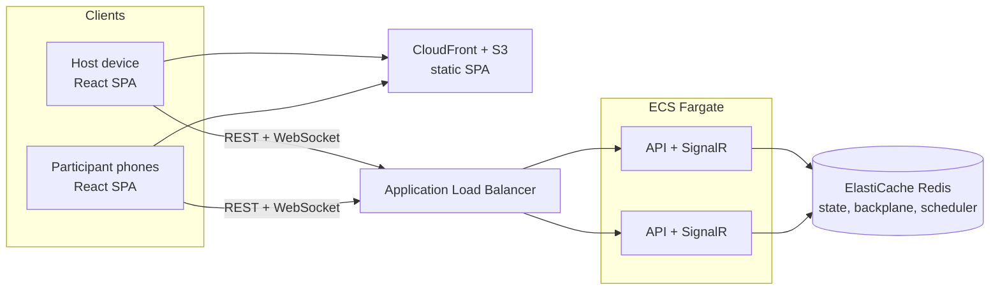
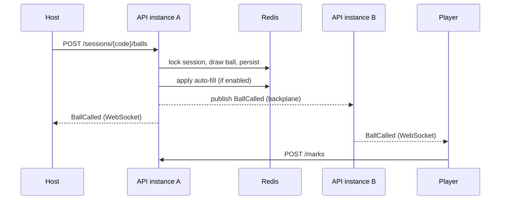

# 02 — Architecture

## 1. System context



Locally, the same shape runs in Docker Compose: `web`, `api`, `valkey`.

## 2. Design decisions at a glance

| Concern | Decision | ADR |
|---------|----------|-----|
| Source of truth | Server-authoritative game state | 0001 |
| Transport | REST for commands, SignalR for server→client events | 0002 |
| Persistence | Redis-compatible store (Valkey) with TTL; no relational database | 0003, 0011 |
| Rules | Variants and win patterns as data (bitmasks) | 0004 |
| Identity | No accounts; opaque session tokens | 0005 |
| Game code | 16 chars, ambiguity-free alphabet, CSPRNG | 0006 |
| Hosting/IaC | AWS CDK in C#: **Lean** live site on one instance (Compose: Caddy, API, Valkey); **Full** design on ECS Fargate (arm64) for the portfolio | 0007, 0011 |
| Wins | Host-credited | 0008 |
| Custom content | Callable items with call and card faces; text-only sets with limits | 0009 |
| Displays | TV pairing with a short code | 0010 |

## 3. Backend

### 3.1 Solution layout

Target framework: **.NET 10** (LTS). The SDK version is pinned in `global.json`.

```
SyncBingo/
├─ src/
│  ├─ SyncBingo.Domain/           # pure C#: no I/O, no framework deps
│  ├─ SyncBingo.Application/      # commands, handlers, ports (interfaces)
│  ├─ SyncBingo.Infrastructure/   # Redis store, scheduler, token/password hashing
│  └─ SyncBingo.Api/              # ASP.NET Core: endpoints, SignalR hub, auth, DI
├─ tests/
│  ├─ SyncBingo.Domain.Tests/
│  ├─ SyncBingo.Application.Tests/
│  └─ SyncBingo.Api.IntegrationTests/    # Testcontainers (Redis) + WebApplicationFactory
├─ web/                            # React + TypeScript (Vite)
├─ infra/                          # AWS CDK (C#)
├─ docs/
└─ docker-compose.yml
```

### 3.2 Layers

- **Domain** — `Session`, `Round`, `Participant`, `Card`, `ICardGenerator`, `BingoVariant`, `WinPattern`, `WinCondition`, game-code generator, state machine rules. Deterministic and trivially unit-testable (random source injected).
- **Application** — one handler per command (`CreateSession`, `JoinSession`, `MarkSquare`, `DrawBall`, `StartRound`, …). Each handler: authorize → take the session lock (shared-state commands) → load → apply domain rule → persist → keep the auto-call schedule in step → publish (private notifications such as auto-fill first, then session events). Shared-state commands share one pipeline, `SessionCommandRunner`. Ports: `ISessionStore`, `IEventPublisher`, `ICallScheduler`, `IClock`, `IRandomSource` (domain), `ITokenService`, `IPasswordHasher`.
- **Infrastructure** — `RedisSessionStore`, `RedisCallScheduler`, hashing, TTL policy.
- **Api** — minimal API endpoints (REST commands), `GameHub` (SignalR, server→client only), authentication handler for session tokens, rate limiting, ProblemDetails, health checks, OpenAPI.

### 3.3 Cross-cutting

Structured logging (Serilog → CloudWatch), correlation IDs, ASP.NET Core rate limiter (wrong game passwords per code + IP, game creation per IP, marks per player; docs/05 §5), health endpoints (`/healthz`, `/readyz` incl. Redis), OpenAPI document published from CI.

## 4. Real-time design

- Commands travel over **REST** (easy to test, idempotent, clear HTTP semantics). The **SignalR hub only pushes**: it keeps open connections and fans out events.
- Each connection authenticates with its session token and joins one SignalR group per role: `s:{code}:players`, `s:{code}:host`, or `s:{code}:display` (the read-only display view, FR-28). Events addressed to "all" go to all three; private events go only to the right group or connection.
- **Redis backplane** lets any API instance publish to connections held by another instance.
- Every pushed event carries a monotonically increasing `seq`. A client that detects a gap, or reconnects, calls `GET /sessions/{code}/snapshot` and rebuilds state. Events are hints; the snapshot is truth.
- Clients use WebSockets only (`skipNegotiation`), which avoids sticky-session requirements behind the ALB.



## 5. Auto-call scheduling

Auto mode needs exactly one instance to draw per tick, without a leader.

- Redis sorted set `bingo:schedule` — member = session code, score = next due time (ms). The one entry per session is whatever is due next: the end of a round countdown (FR-45), or the next auto-call ball. The tick does whichever applies to the session's state.
- Every instance runs a `BackgroundService` polling every 500 ms. A Lua script **claims** up to 50 due sessions atomically by moving their score to `now + lease` (5 s) and returning them; the instance ticks up to 8 of them at once.
- The claiming instance takes the session lock, draws, then re-schedules at `now + interval`.
- If an instance dies mid-claim, the lease expires and another instance picks the session up. No ball is lost; at worst one draw is delayed by the lease. A tick that throws (Redis down, lock timeout) is left the same way, so it is retried.
- A tick the rules refuse (for example, the session is gone) takes the session off the schedule, but only if its score is still that claim's lease: if the host re-scheduled it meanwhile (*Auto mode* right after), the new entry stays.
- Logs name a session by the first group of its code only: enough to correlate, not enough to join.
- *Start Round N* schedules the session at the countdown's end; *Cancel* removes it. At zero the tick starts the round; a manual round leaves the schedule, an auto round re-schedules after its first ball.
- *Auto mode* draws one ball inside the command and adds the session to the schedule at `now + interval`; *Pause*, *Alert host and pause* and *Clear cards* remove it.

## 6. Concurrency and consistency

- Mutations that change shared session state (draw, pause, start/end round, settings, win condition) run under a **short per-session Redis lock** and bump a session `version`. The lock is `SET NX` with a random owner value and a 10 s lease (a crashed holder's lock frees itself), released by a compare-and-delete script so a holder whose lease ran out can never release its successor's lock. A command waits up to 5 s for the lock, then fails (the API will answer 503).
- Participant-only mutations (marks, Undo, the auto-fill switch) take no lock and touch just that participant's hash field, so 100 players tapping do not contend with the host. A player's redraw is rare and takes the session lock, so it cannot race the round countdown or a host redraw of every card.
- Name uniqueness uses `HSETNX` on a normalized-name index, so two simultaneous joins with the same name cannot both succeed.
- Card uniqueness (FR-39) works the same way: dealing a card `SADD`s its fingerprint to the session's `cards` set and redeals if the fingerprint was already there, so concurrent joins or redraws never end up with identical cards.
- Auto-fill is applied by the server at draw time, inside the draw's critical section, so a fill and the ball that triggers it are consistent.
- A draw's auto-fill writes participants while those players may be marking (their path takes no session lock), so participant saves use **optimistic concurrency**: every participant record carries a version, and a save succeeds only if the record is still at the version that was loaded (a Lua compare-and-set in Redis). The loser reloads and applies its change again, up to 5 tries, then the player sees "please try again" (409). A player's change reloads the session as well, so a mark that raced *Clear cards* is judged again under the new state and refused. A removed player's save finds no record and fails.
- Joining also takes the session lock, so the choice between a card now and the waiting room (FR-5) cannot race a round starting; every command that returns the game to the lobby admits the waiting under the same lock; the name and card claims inside it stay atomic in their own right.

## 7. Frontend

React 19 + TypeScript (strict), Vite, React Router, Tailwind CSS v4; state lives in a `useGame` hook (the snapshot plus the event stream), no state library; `@microsoft/signalr`, `qrcode` for client-side QR rendering.

```
web/src/
├─ app/            # Layout (header, footer, ad slots), AdSlot + ads.ts (provider switch, ADR 0012),
│                  # palettes.ts (color themes), theme.ts (light/dark), NotFound
├─ api/            # client.ts (openapi-fetch + ApiError) and schema.d.ts, generated from the API's OpenAPI
├─ realtime/       # gameConnection.ts (SignalR, seq tracking, resync), pairingConnection.ts (TV pairing)
├─ storage/        # sessions.ts (this browser's seat in each game), setDrafts.ts (set editor drafts)
├─ features/
│  ├─ game/        # shared by every screen: useGame (snapshot + events), gameEvents.ts (applyEvent),
│  │               # rules.ts (Options sections, rule sentences), patterns, CallBoard, LastBall, Dialog, Menu, ui
│  ├─ landing/     # the front door
│  ├─ host/        # create, console, Options, own patterns, players, claims, displays, join panel
│  ├─ play/        # join page, play screen, card, mark styles, rules panel
│  ├─ display/     # display view, /tv pairing, /pair
│  ├─ sets/        # the set editor and its pure logic (draft.ts, setFile.ts, text.ts)
│  ├─ guide/       # How to play, FAQ and the glossary (content pages, ADR 0012)
│  └─ legal/       # Terms and Privacy
└─ test/           # Vitest setup, fixtures, fake API
```

Routes: `/`, `/how-to-play`, `/faq`, `/host/new`, `/host/:code`, `/host/:code/set` (set editor), `/join` (manual), `/join/:code` (QR target), `/play/:code`, `/display/:code`, `/tv`, `/pair/:pairingCode`, `/terms`, `/privacy`, and a not-found page for anything else.

State rules: each screen holds one snapshot (`useGame`), loaded from `GET /snapshot` and kept current by `applyEvent`; events it can't absorb, a gap in `seq` or a reconnect trigger a refetch. A command's reply may patch the snapshot at once (a mark or Undo returns the card's marks); there is no optimistic UI beyond that.

## 7a. Security notes

- Game password and session tokens are hashed at rest (PBKDF2-HMAC-SHA256 for the password, 04 §5; SHA-256 of a 256-bit random token for session tokens).
- Wrong game passwords are limited per code and IP to blunt guessing; correct joins are never slowed, so a class behind one school address can join at once.
- Participants only ever receive their own card; host card inspection is host-only.
- All inputs validated server-side (name length and allowed characters, cell index, state preconditions).
- **Untrusted text is data, never code.** Names (and, later, custom content) are the only free text players send, and they are never spliced into anything that gets interpreted:
  - *Storage:* there is no SQL database. Redis commands send every value as a separate argument, and Lua scripts receive values through `ARGV`, never by building script text. Redis **key names** are built only from validated game codes and server-generated ids, never from a name.
  - *Browser:* React renders names as text. `dangerouslySetInnerHTML` is banned by an ESLint rule. A Content-Security-Policy header on the site (nginx locally, CloudFront in AWS) is planned for the Phase 2 hardening pass.
  - *Logs:* structured logging records names as properties. Line breaks are collapsed to spaces during name validation, so a name cannot forge log lines.
  - *Exports (future):* any CSV or spreadsheet export must escape values starting with `=`, `+`, `-` or `@` so a name cannot run as a formula.
  - Name validation (`docs/04` §5) is a second layer on top of this: injection syntax such as `'); DROP TABLE x;--` is already refused by the character rules, while harmless words like "DROP TABLE" are allowed.

## 8. Observability

Logs: Serilog JSON → CloudWatch. Metrics: active sessions, connected clients, draws/sec, join failures. Optional OpenTelemetry traces. Alarms on Redis memory, 5xx rate and unhealthy targets.
