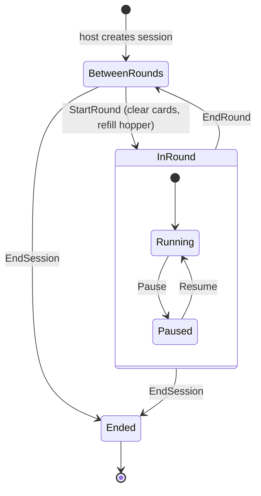
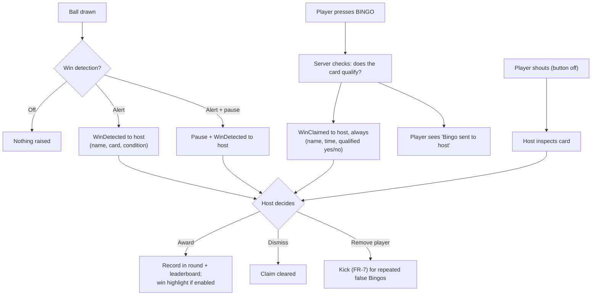

# 03 — Game State Machine

## 1. Lifecycle



- **BetweenRounds** is also the initial lobby (zero rounds played). Cards keep the previous round's marks until the next round starts.
- **InRound** lasts while the cards carry marks. *Clear cards* from inside a round is shorthand for `EndRound` + `StartRound`.
- **Ended** is reached by the host ending the session or by TTL expiry. All data is then discarded.

## 2. Commands by state

| Command | BetweenRounds | Running | Paused | Notes |
|---------|:---:|:---:|:---:|-------|
| Join (password + name) | ✔ | ✖ | ✖ | FR-5 |
| Start round / Clear cards | ✔ | ✔ (ends current) | ✔ (ends current) | Refills hopper, clears marks, optional redraw |
| End round | – | ✔ | ✔ | Freezes cards, shows leaderboard |
| Pause / Resume | – | ✔ / – | – / ✔ | Pause cancels the auto-call schedule |
| Draw ball ("Grab a new ball") | – | ✔ | ✔ | Explicit host action, allowed while paused (A6) |
| Auto draw (scheduler) | – | ✔ | ✖ | Only in Auto mode |
| Mark square | ✖ | ✔ | ✔ | *Free marking* on: any square. Off: called numbers only (FR-22) |
| Unmark square | ✖ | ✔ | ✔ | Only if *Allow unmarking* is on (FR-24). The free cell is always marked |
| Claim Bingo | ✖ | ✔ | ✔ | Only if Bingo button enabled. Always alerts the host, valid or not (FR-37a) |
| Change win condition | – | ✔ | ✔ | Same ball draw and marks continue |
| Change settings | ✔ | ✔ | ✔ | Some apply from the next round (e.g. redraw policy) |
| Redraw card (participant) | ✔ if allowed | ✖ | ✖ | Policy FR-20 |
| Redraw cards (host) | ✔ | – | – | At round start |
| Award win | – | ✔ | ✔ | Credits a participant; feeds leaderboard |
| Dismiss claim | – | ✔ | ✔ | Host clears a claim without awarding it |
| Toggle own auto-fill (participant) | ✔ | ✔ | ✔ | Only if the host made auto-fill available (FR-16) |
| Kick participant | ✔ | ✔ | ✔ | |
| View leaderboard | ✔ | ✔ | ✔ | Host decides if shown to all |

## 3. Ball drawing

1. Hopper = variant's ball set (1–75) minus balls already called this round.
2. Draw uses an injected random source (CSPRNG in production, seeded in tests).
3. Each draw increments `sequence` and records `{ball, letter, calledAt}`.
4. **Auto-fill:** for each participant who switched auto-fill on (only possible while the host makes it available), every card containing the *previous* ball that is not yet marked gets it marked, **before** the new ball is announced. A missed number therefore stays fillable by the player for one full call interval, and the last ball of a round is never auto-filled.
5. If **win detection** is on, every card is checked against the current win condition using the **called** numbers (see §4). Marks play no part, so detection only runs here, inside the draw's critical section, and never on the marking path.
6. When the hopper is empty the host is told; no further draws until a new round.

## 4. Win handling

A completed pattern is only a *potential* win. A player wins by **claiming** (pressing BINGO, or shouting it when the button is off) and the host **awarding** the win (ADR 0008).

Two masks matter for each card:

- **called** = the cells whose numbers have been called this round, plus the free cell;
- **marks** = what the player marked (may include mismarks, FR-22).

A card *qualifies* for the current win condition when `(called & mask) == mask` for one of its masks; with *Require marks for claims* on (FR-23) it uses `called & marks` instead. For Normal Bingo, any of the 12 line masks counts.



Rules:

- Detection runs only when a ball is drawn, against called numbers, so marks (or mismarks) can never trigger or suppress an alert, and *Alert + pause* happens inside the draw's critical section.
- A card raises **at most one detection alert per win condition per round**. Claims are not limited: every press reaches the host, who can remove a player who abuses the button.
- Claim order is recorded with a server timestamp so the host can see who was first.
- The host can **award a win** to one or several participants, including when detection and the Bingo button are both off (serious mode: a player shouts, the host verifies via *inspect card*, then awards).
- A participant may win more than once per round, once for each win condition the host plays.
- Awarding is idempotent for the same participant + win condition + round.

## 5. Win patterns (5×5, row-major, centre = free)

Normal Bingo: any of 5 rows, 5 columns, 2 diagonals. Four Corners: cells 0, 4, 20, 24. Blackout: all 25.

Letter shapes (`X` = required cell):

```
 B        I        N        G        O
XXXX.    XXXXX    X...X    XXXXX    XXXXX
X...X    ..X..    XX..X    X....    X...X
XXXX.    ..X..    X.X.X    X.XXX    X...X
X...X    ..X..    X..XX    X...X    X...X
XXXX.    XXXXX    X...X    XXXXX    XXXXX
```

These are data, not logic: each shape is written as a picture like the ones above (`StandardVariants.Classic75`) and every pattern is checked by the same evaluator, so shapes can be tuned or new patterns added without new code. Loading variants and patterns from configuration files is deferred until custom variants are built (roadmap Phase 4).
