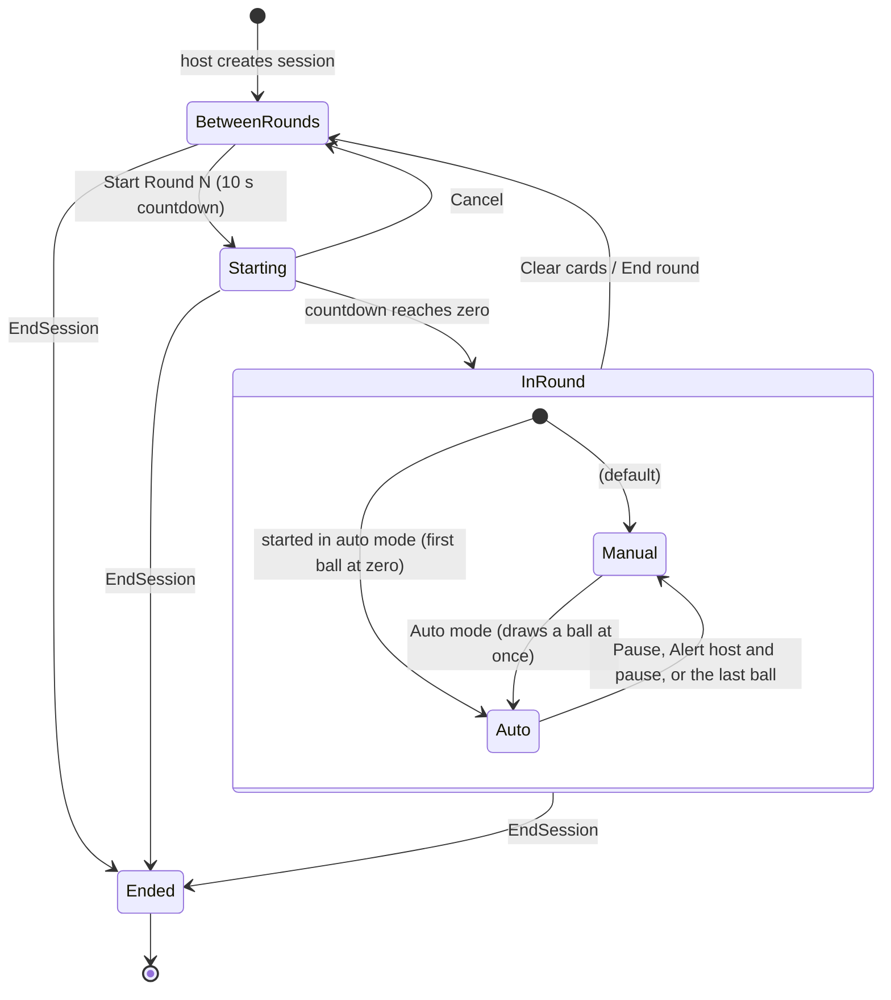
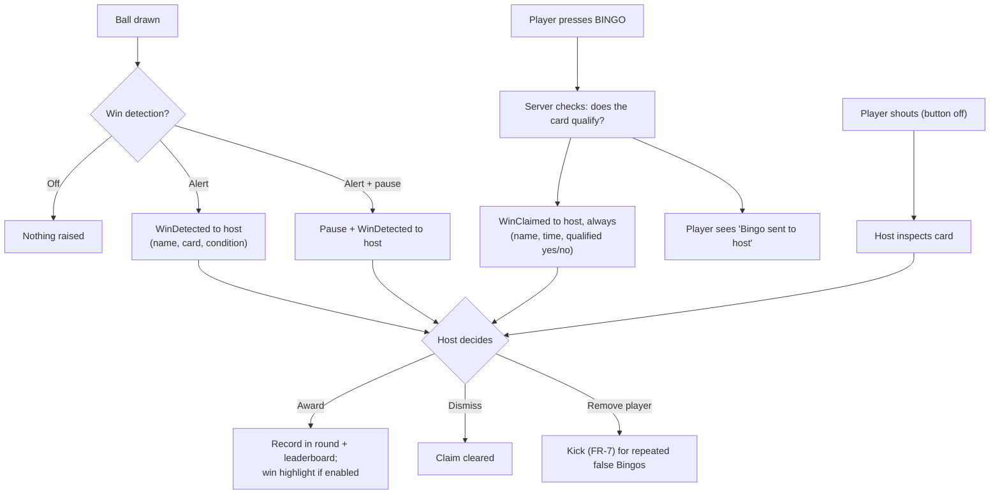

# 03 — Game State Machine

## 1. Lifecycle



- **BetweenRounds** is the lobby, before the first round and between rounds. Joining and (per FR-20) card redraws happen here. The host's main button reads **Start Round N** (or **Start New Round** with *Show round numbers* off, FR-46), with a **Manual / Auto** toggle beside it, Manual by default.
- **Starting** is the 10-second countdown (FR-45). Joining and redraws are closed from its first second; the host can **Cancel** back to the lobby. At zero the scheduler starts the round, under any round-scoped settings that were waiting, and every player's marks are reset for those settings.
- **InRound** starts in **Manual** (the host draws with *Grab ball*), or in **Auto** if the toggle said so, with its first ball drawn at zero. **Auto** draws on a timer until the host presses *Pause*. Players can mark in both.
- **Clear cards** ends the round (if one is running), clears marks and called balls, and returns to the lobby, so late arrivals can join before the next round. **End round** stops the round but leaves the cards and calls on screen.
- **Ended** is reached by the host ending the session or by TTL expiry. All data is then discarded.

## 2. Commands by state

| Command | BetweenRounds | Starting | Manual | Auto | Notes |
|---------|:---:|:---:|:---:|:---:|-------|
| Join (password + name) | ✔ | ✖ | ✖ | ✖ | FR-5: "A round is in progress. You can join between rounds." |
| Start Round N | ✔ | – | – | – | Starts the 10 s countdown (FR-45), with the Manual/Auto toggle |
| Cancel countdown | – | ✔ | – | – | Back to the lobby; joining reopens |
| Round start (at zero) | – | ✔ | – | – | Scheduler only; refills the hopper and resets marks |
| Clear cards | ✔ | ✖ | ✔ (ends current) | ✔ (ends current) | Clears marks and calls, back to the lobby (FR-34) |
| End round | – | – | ✔ | ✔ | Stops the round; cards and calls stay visible |
| Auto mode | – | – | ✔ | – | Draws a ball at once, then schedules the next after the interval. Not within 3 s of a mid-round rules change (FR-47) |
| Pause | – | – | – | ✔ | Back to manual: cancels the auto-call schedule. No banner is shown |
| Grab ball (host) | – | – | ✔ | ✖ | Manual mode only (FR-11). Not within 3 s of a mid-round rules change: "Give everyone a moment to read the new rules." (FR-47) |
| Auto draw (scheduler) | – | – | ✖ | ✔ | Auto mode only |
| Mark square | ✖ | ✖ | ✔ | ✔ | *Free marking* on: any square. Off: called numbers only (FR-22), and the free centre only once earned (FR-26) |
| Unmark square | ✖ | ✖ | ✔ | ✔ | Per *Unmarking* (FR-24): any square, uncalled squares only, or never. With an *Always marked* free space the centre can never be unmarked; with *None* the centre is an ordinary square |
| Undo (participant) | ✖ | ✖ | ✔ | ✔ | Always allowed: resets the card to its marks when the last ball was called (FR-25) |
| Claim Bingo | ✖ | ✖ | ✔ | ✔ | Any time during a round, even while the next ball waits after a rules change. Always alerts the host, valid or not (FR-37a) |
| Apply rules (Options → Apply) | ✔ | ✖ | ✔ | ✖ | Settings and pattern together, in one step. Before a round: picks its rules; a new card size (FR-26a) or a free space added or taken away deals everyone a new card. Mid-round: the same balls and marks continue; card size, free space, redraw policy and multiple wins are lobby only, so an Apply changing them is refused. Refused in auto mode ("Pause before changing the rules") and during the countdown, so the host can announce the change while nothing is being called |
| Redraw card (participant) | ✔ if allowed | ✖ | ✖ | ✖ | Policy FR-20 |
| Deal New Cards (host) | ✔ | ✖ | ✖ | ✖ | A fresh card for every player, in the lobby only (FR-34) |
| Use this set / back to numbers (host) | ✔ | ✖ | ✖ | ✖ | A custom set, or numbers again (FR-44, ADR 0009): clears the last round's calls and deals every player a new card; a set that doesn't fit the card is refused with the reason |
| Award win | – | – | ✔ | ✔ | Credits a participant; feeds leaderboard |
| Dismiss claim | – | – | ✔ | ✔ | Host clears a claim without awarding it |
| Toggle own auto-fill (participant) | ✔ | ✔ | ✔ | ✔ | Only if the host made auto-fill available (FR-16) |
| Remove (kick) participant | ✔ | ✔ | ✔ | ✔ | Dismisses their pending claims; wins already awarded stay in the history |
| Leave game (participant) | ✔ | ✔ | ✔ | ✔ | As a removal, but announced as "Ava left the game" (FR-53); they can join again only between rounds |
| Show leaderboard to all | ✔ | ✔ | ✔ | ✔ | The host always sees it; this shows or hides it for participants and the display |

## 3. Ball drawing

1. Hopper = variant's ball set (1–75) minus balls already called this round.
2. Draw uses an injected random source (CSPRNG in production, seeded in tests).
3. Each draw increments `sequence` and records `{ball, letter, calledAt}`.
4. **Auto-fill:** for each participant who switched auto-fill on (only possible while the host makes it available), every card containing the *previous* ball that is not yet marked gets it marked, **before** the new ball is announced. A missed number therefore stays fillable by the player for one full call interval, and the last ball of a round is never auto-filled.
5. If **win detection** is on, every card is checked against the current win condition using the **called** numbers (see §4). Marks play no part, so detection only runs here, inside the draw's critical section, and never on the marking path.
6. When the hopper is empty the host is told; no further draws until a new round.

## 4. Win handling

A completed pattern is only a *potential* win. A player wins by **claiming** (pressing BINGO, or shouting it when the button is off) and the host **awarding** the win (ADR 0008).

Two masks matter for each card:

- **called** = the cells whose numbers have been called this round, plus the free cell when it counts: always with an *Always marked* free space, and with an *Earned* free space only once a called ball is not on this card (FR-26);
- **marks** = what the player marked (may include mismarks, FR-22).

A card *qualifies* for the current win condition when `(called & mask) == mask` for one of its masks; with *Require marks for claims* on (FR-23) it uses `called & marks` instead. For Normal Bingo, any of the 12 line masks counts.



Rules:

- Detection runs only when a ball is drawn, against called numbers, so marks (or mismarks) can never trigger or suppress an alert, and *Alert + pause* happens inside the draw's critical section.
- A card raises **at most one detection alert per win condition per round**. Claims are not limited: every press reaches the host, who can remove a player who abuses the button.
- Claim order is recorded with a server timestamp so the host can see who was first.
- The host can **award a win** to one or several participants with no claim at all, e.g. with detection off (serious mode: a player shouts "Bingo!" instead of pressing the button, the host verifies via *inspect card*, then awards).
- How many wins a card can earn in a round follows *Multiple wins* (FR-43): once per round, once per pattern (default), or every declared win (the host awards the number declared, e.g. 2 for a double Bingo).
- Claims and detection alerts carry the number of lines the card completes; claims also carry the wins it already got for this pattern this round and how many more are **awardable** under *Multiple wins*, so the host sees "No awardable matches" when there are none. This informs the host; it does not block an award. A Bingo **not on called numbers** can still be awarded, but the host console asks first ("Award a Bingo that isn't on the called numbers?").
- In the "once" modes a claim also says whether the card **already won** (this pattern, or once per round anything, this round). Such a claim gets no Award button, only Inspect and Dismiss, since an award would change nothing. If one is awarded anyway (an older screen, or a manual award), the award still changes nothing and **closes the card's open claims**, so none is left waiting.
- Detection alerts once per card, pattern and round; with *every declared win* it alerts again when more lines complete; with *once per round* a card that has won is not checked again.
- Repeating an award changes nothing: the same card and pattern in the "once" modes, or the same claim in any mode (a double click).

## 5. Win patterns (5×5, row-major, centre = free)

Rows: any of the 5 rows. Columns: any of the 5 columns. Diagonals: either diagonal. **Normal Bingo** is those three together, a preset. Four Corners: cells 0, 4, 20, 24. Blackout: all 25.

The host selects **one or more** patterns (FR-21); a card wins when it completes any line or shape of any selected pattern, and "N lines" counts across all of them. The selection is the round's win condition: in the "once" modes a card wins **once per selection**, and choosing a different selection mid-round allows another win. A win is announced as "Ava had a Bingo!", or by the shape when that is the only pattern complete ("Ava had Four Corners!"); the host's alerts list everything complete ("✓ 2 lines: Rows, Four Corners").

Letter shapes (`X` = required cell):

```
 B        I        N        G        O
XXXX.    XXXXX    X...X    XXXXX    XXXXX
X...X    ..X..    XX..X    X....    X...X
XXXX.    ..X..    X.X.X    X.XXX    X...X
X...X    ..X..    X..XX    X...X    X...X
XXXX.    XXXXX    X...X    XXXXX    XXXXX
```

These are data, not logic: each shape is written as a picture like the ones above (`StandardVariants.Classic75`) and every pattern is checked by the same evaluator, so shapes can be tuned or new patterns added without new code. Loading variants and patterns from configuration files is deferred until custom variants are built (roadmap Phase 4).
