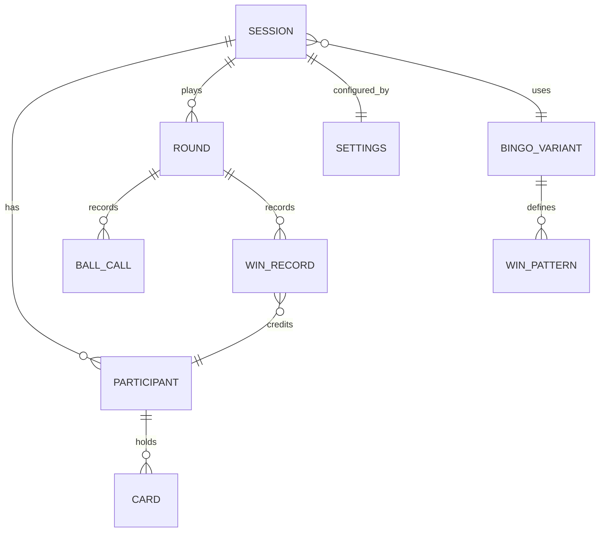

# 04 — Data Model

Everything is ephemeral. There is no relational schema; live state sits in Redis with a TTL and disappears with the session.

## 1. Domain model

| Entity | Key fields |
|--------|-----------|
| **Session** | `code`, `passwordHash`, `state`, `version`, `createdAt`, `lastActivityAt`, `variantId`, `currentRoundNumber` |
| **Settings** | auto-call interval, showBallToPlayers, highlightMatches, showCallBoard, autoFillAvailable, freeMarking, unmarking (off / mismarksOnly / any), freeSpace (alwaysMarked / earned; changes apply next round), requireMarksForClaims, bingoButton, winHighlight, winDetection, redrawPolicy, currentWinCondition |
| **Participant** | `id`, `name`, `nameKey` (normalised), `tokenHash`, `joinedAt`, `connected`, `autoFillOn`, `cards[]` |
| **Claim** | `participantId`, `cardId`, `winCondition`, `claimedAt`, `qualified` (did the card qualify at that moment), `status` (pending/awarded/dismissed) |
| **Card** | `id`, `cells[25]` (numbers, centre = 0 for free), `fingerprint` (the cells joined, e.g. `7-22-38-…`), `marks` (25-bit mask; the centre bit starts set with an *Always marked* free space and unset with an *Earned* one), `undoMarks` + `undoSequence` (the marks to restore on Undo and the ball they belong to), `issuedInRound` |
| **Round** | `number`, `startedAt`, `endedAt`, `winConditionsUsed[]`, `balls[]`, `wins[]` |
| **BallCall** | `sequence`, `number`, `letter`, `calledAt`, `mode` (auto/manual) |
| **WinRecord** | `participantId`, `cardId`, `winCondition`, `claimedAt`, `awardedAt`, `source` (detected/claimed/manual) |
| **BingoVariant** | `id`, `ballMax` (75), `columns` (5), `rows` (5), `columnRanges`, `freeCell`, `patterns[]` |

**Settings defaults** (`SessionSettings.Default`): 10 s auto-call interval (allowed 3–120 s), show ball on, highlight matches off, show call board on, auto-fill available off, Bingo button on, win highlight on, win detection *Alert host*, redraw policy *Host controls*, free marking on, require marks off, unmarking *Any*, free space *Always marked*. *Free space* and *Redraw policy* are round-scoped: changed mid-round, they are held as `nextRoundSettings` and apply when the next round starts.

A participant holds a **list** of cards. The MVP always has exactly one; the list exists so "Serious Bingo" (multiple purchased cards) needs no model change.

## 2. Card generation

For each column *c* (B, I, N, G, O): choose 5 distinct numbers from `[15c+1 … 15c+15]` (4 for the N column; the centre is the free cell), and place them in random order down the column (not sorted, as on a real card). A redraw regenerates all 25 cells. Property tests assert: correct ranges, no duplicates within a card, free cell set.

Cards are dealt through `ICardGenerator`; the standard implementation is `ColumnCardGenerator`, which follows the column ranges above. Cards hold item ids (ball numbers here), so other content such as "2 + 5" called and "7" marked can be added later with its own generator and content set (ADR 0009).

**No identical cards in play (FR-39).** Two cards are the same when every cell holds the same number; the card's `fingerprint` captures exactly that. The generator deals a candidate and asks the caller to *claim* its fingerprint; if the claim fails (the card is already in play), it deals again, giving up with an error after 1,000 tries (a real 75-ball session never gets near that: there are about 5.5 × 10²⁶ distinct cards). The claim must be atomic so that two concurrent deals cannot both win the same card; see the `cards` set in §4.

## 3. Bitmask representation

- Cell index `i = row * 5 + col`; bit `i` of `marks` is 1 if marked.
- A `WinPattern` is `{ id, name, masks: uint[] }` (any mask satisfied wins; one mask for most patterns, twelve for Normal Bingo).
- `IsWin(marks, pattern) = pattern.masks.Any(m => (marks & m) == m)`.
- Changing card size or ball range later means changing `BingoVariant` data, not the evaluator.

## 4. Redis layout

All keys are prefixed `bingo:` and carry the same TTL (idle expiry, refreshed on activity; hard cap of 12 hours on total lifetime).

| Key | Type | Contents |
|-----|------|----------|
| `s:{code}:meta` | hash | state, version, passwordHash, current round number, settings (JSON), variant id |
| `s:{code}:participants` | hash | field = participantId → participant JSON (incl. cards and marks) |
| `s:{code}:names` | hash | normalised name → participantId (`HSETNX` enforces uniqueness) |
| `s:{code}:tokens` | hash | tokenHash → participantId |
| `s:{code}:cards` | set | fingerprints of every card currently in play (`SADD` returns 1 only for the first claimant; `SREM` when a card is replaced or its holder is kicked) |
| `s:{code}:round:{n}` | hash/list | round summary, ordered ball calls, win records |
| `s:{code}:stats` | hash | wins per participant, rounds played |
| `schedule` | sorted set | session code → next auto-call due time (see 02 §5) |
| (pub/sub) | channels | SignalR backplane |

**Undo (FR-25) without extra writes per draw:** the first time a player changes a card after ball *n* is called, the server saves the card's marks from just before that change as `undoMarks` with `undoSequence = n`. Undo restores `undoMarks` when `undoSequence` is the current ball, and does nothing otherwise (no change since that ball). Auto-fill happens during the draw, before any player change, so it is part of the saved state. A draw therefore never has to touch every card just to support Undo.

Marks and redraws update one `participants` field; a redraw also claims the new card's fingerprint and releases the old one. A host redraw of every card at round start runs under the session lock: it clears the `cards` set, then deals and claims each new card. Draw, pause, round changes and settings take the per-session lock and bump `version`.

## 5. Identity and secrets

- **Game code:** 16 characters from `23456789abcdefghjkmnpqrstuvwxyz` (31 symbols, ≈ 79 bits), generated with a CSPRNG, displayed as `xxxx-xxxx-xxxx-xxxx`. Input is accepted case-insensitively with or without hyphens.
- **Game password:** chosen by the host; stored as a salted PBKDF2/Argon2 hash.
- **Session token:** 256-bit random value returned once at join; only its SHA-256 is stored. The client keeps it in `localStorage` and sends it as a bearer token (and as `access_token` for the WebSocket).
- **Host token:** same mechanism, stored separately from participants: the host runs the game and is not a participant (FR-15 removed).
- **Pairing** (ADR 0010): `pairing:{code}` (string, 10-minute TTL, deleted when used) holds the waiting TV's pairing id until a host approves it; the code is 6 characters from the game-code alphabet.
- **Display token:** same mechanism, role `display`: **read-only**, sees only public game state (FR-28), and the host can revoke it. Stored as hashes in `s:{code}:display-tokens`. The display link carries it in the URL **fragment** (`/display/{code}#t=…`), which browsers never send to the server, so it does not appear in server or CDN logs; the page moves it to `sessionStorage` and clears it from the address bar.
- **Names** (`ParticipantName`):
  - Unicode-normalised (NFKC, so full-width "ＳＡＭ" or a decomposed "é" count the same as the plain forms), trimmed, and inner whitespace collapsed to one space.
  - Allowed: letters in any script (with accents), digits, spaces and `' - _ .`, with at least one letter or digit. Emoji, symbols, and invisible or control characters (zero-width spaces, right-to-left overrides) are refused.
  - 1–20 characters as a reader counts them (grapheme clusters), plus a cap of 60 UTF-16 units against stacked accent marks.
  - Uniqueness compares the lowercase form (`Key`); the tidied form (`Display`) is what everyone sees.
  - A basic profanity filter (configurable), because children are expected users, follows in Phase 2.

## 6. Reserved for "Serious Bingo" (not built in the MVP)

- `CardClaim`: `{ id, sessionCode, issuedAt, expiresAt, redeemedBy? }`, a single-use claim stored at `s:{code}:claims:{id}`. The host's "generate card" returns a claim QR; scanning it redeems the claim and adds a card to the scanner's participant record. The host can also add a card directly to a participant.
- Cards carry `issuedInRound`; cards issued this way are removed when the round ends.
