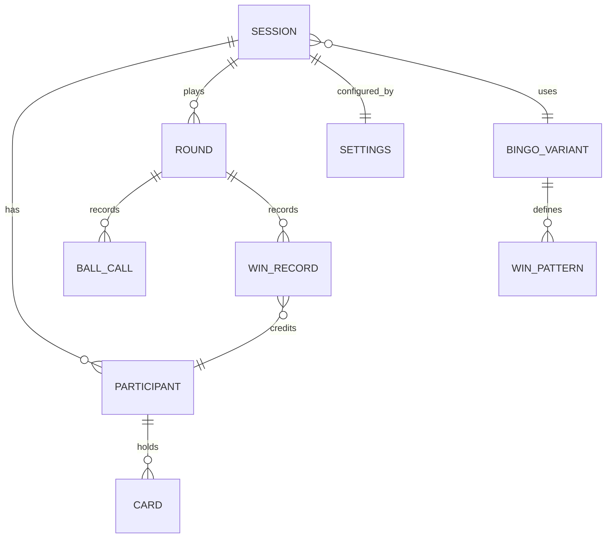

# 04 — Data Model

Everything is ephemeral. There is no relational schema; live state sits in Redis with a TTL and disappears with the session.

## 1. Domain model

| Entity | Key fields |
|--------|-----------|
| **Session** | `code`, `passwordHash`, `state` (betweenRounds / starting / manual / auto / ended), `version`, `createdAt`, `lastActivityAt`, `variantId`, `currentRoundNumber`, `countdownEndsAt` and `startInAuto` (during a countdown) |
| **Settings** | auto-call interval, showBallToPlayers, highlightMatches, showCallBoard, autoFillAvailable, freeMarking, unmarking (off / mismarksOnly / any), freeSpace (alwaysMarked / earned; lobby only), callBoardFace (ball / square), showRoundNumbers, multipleWins (oncePerRound / oncePerPattern / everyDeclaredWin; lobby only), requireMarksForClaims, winHighlight, winDetection, redrawPolicy, currentWinCondition |
| **Participant** | `id`, `name`, `nameKey` (normalised), `tokenHash`, `joinedAt`, `connected`, `autoFillOn`, `cards[]` |
| **Claim** | `participantId`, `cardId`, `winCondition`, `claimedAt`, `matches` (lines completed at that moment; 0 = not qualified), `alreadyAwarded` (wins this card already got for this pattern this round), `awardable` (more wins possible under *Multiple wins*; 0 = "no awardable matches"), `status` (pending/awarded/dismissed) |
| **Card** | `id`, `cells[25]` (numbers, centre = 0 for free), `fingerprint` (the cells joined, e.g. `7-22-38-…`), `marks` (25-bit mask; the centre bit starts set with an *Always marked* free space and unset with an *Earned* one), `undoMarks` + `undoSequence` (the marks to restore on Undo and the ball they belong to), `issuedInRound` |
| **Round** | `number`, `startedAt`, `endedAt`, `winConditionsUsed[]`, `balls[]`, `wins[]` |
| **BallCall** | `sequence`, `number`, `letter`, `calledAt`, `mode` (auto/manual) |
| **WinRecord** | `round`, `participantId`, `cardId`, `winCondition`, `awardedAt`, `source` (detected/claimed/manual), `wins` (1, or more for a declared multiple win) |
| **BingoVariant** | `id`, `ballMax` (75), `columns` (5), `rows` (5), `columnRanges`, `freeCell`, `patterns[]` |

**Settings defaults** (`SessionSettings.Default`): 10 s auto-call interval (allowed 3–120 s), show ball on, highlight matches off, show call board on, auto-fill available off, win highlight on, win detection *Alert host*, redraw policy *Host controls*, free marking on, require marks off, unmarking *Any*, free space *Always marked*, call board shows the *ball* side, round numbers shown, multiple wins *once per pattern*. *Free space*, *Redraw policy* and *Multiple wins* are round-scoped: they shape a whole round, so they can change only in the lobby, and an Apply that changes one mid-round is refused (422, naming them) with nothing applied.

A participant holds a **list** of cards. The MVP always has exactly one; the list exists so "Serious Bingo" (multiple purchased cards) needs no model change.

## 2. Card generation

For each column *c* (B, I, N, G, O): choose 5 distinct numbers from `[15c+1 … 15c+15]` (4 for the N column; the centre is the free cell), and place them in random order down the column (not sorted, as on a real card). A redraw regenerates all 25 cells. Property tests assert: correct ranges, no duplicates within a card, free cell set.

Cards are dealt through `ICardGenerator`; the standard implementation is `ColumnCardGenerator`, which follows the column ranges above. Cards hold item ids (ball numbers here), so other content such as "2 + 5" called and "7" marked can be added later with its own generator and content set (ADR 0009).

**No identical cards in play (FR-39).** Two cards are the same when every cell holds the same number; the card's `fingerprint` captures exactly that. The generator deals a candidate and asks the caller to *claim* its fingerprint; if the claim fails (the card is already in play), it deals again, giving up with an error after 1,000 tries (a real 75-ball session never gets near that: there are about 5.5 × 10²⁶ distinct cards). The claim must be atomic so that two concurrent deals cannot both win the same card; see the `cards` set in §4.

## 3. Bitmask representation

- Cell index `i = row * 5 + col`; bit `i` of `marks` is 1 if marked.
- A `WinPattern` is `{ id, name, masks: uint[] }` (any mask satisfied wins; one mask for most patterns, twelve for Normal Bingo).
- `IsWin(marks, pattern) = pattern.masks.Any(m => (marks & m) == m)`.
- Changing card size or ball range later means changing `BingoVariant` data, not the evaluator.

## 4. Redis layout

All keys are prefixed `bingo:`. The code is wrapped in braces, `s:{code}:…`, which Redis Cluster reads as a hash tag: every key of a session lands in the same slot, so one Lua script can check and write several of them atomically. Every check-and-write is such a script.

| Key | Type | Contents |
|-----|------|----------|
| `s:{code}:meta` | hash | `session`: the session snapshot as JSON (state, version, settings, round number, calls, claims, wins, round summaries, alerts already raised); `password`: the password hash |
| `s:{code}:participants` | hash | field = participantId → `{"v": version, "p": participant snapshot}` (cards, marks, Undo state, auto-fill switch); a save is a Lua compare-and-set on `v` (02 §6) |
| `s:{code}:names` | hash | normalised name → participantId (`HSETNX` enforces uniqueness) |
| `s:{code}:tokens` | hash | tokenHash → caller: `host`, `display:{id}` or `participant:{id}` |
| `s:{code}:token-owners` | hash | participantId (or `display:{id}`) → their tokenHash, so removing a player or display revokes the token in the same script |
| `s:{code}:displays` | hash | display id → `{ displayId, kind (Link / Tv), createdAt }`; at most 10 (FR-28) |
| `s:{code}:content` | hash | *(Phase 4)* the session's single custom set, if any: its ball/square pairs of text (call face and card face, 24–500, each side unique) and optional named groups; the *Group items* setting decides whether dealing and the board use them. Text only: no images (ADR 0009, amended) |
| `s:{code}:cards` | set | fingerprints of every card currently in play (`SADD` returns 1 only for the first claimant; `SREM` when a card is replaced or its holder is kicked) |
| `s:{code}:lock` | string | the per-session lock: `SET NX` with a random owner value and a 10 s lease; released only by its owner (compare-and-delete); a command waits up to 5 s for it |
| `pairing-code:{code}` · `pairing:{id}` · `pairing-result:{id}` | strings | TV pairing (ADR 0010): the code → its pairing id (`SET NX`, used with `GETDEL`, so once), the pairing while the TV waits (10 min), and an approved result for a TV that connects a moment later (2 min, taken with `GETDEL`; it holds the display token in clear for that short time). Global keys, not in any session's hash tag |
| `schedule` | sorted set | session code → when its next tick is due (countdown end or next ball), or the end of the lease while an instance has claimed it (see 02 §5). One key for the whole app, outside any session's hash tag |
| (pub/sub) | channels | SignalR backplane |

The whole session is one JSON value rather than a key per round: it is read and written whole under the lock anyway, and stays small because only the current round's calls are kept.

**Expiry:** every write refreshes the expiry of all of a session's keys to the idle time (4 h), so they live and expire together. The 12-hour hard cap is enforced on read: a session older than that reads as gone and its keys are deleted, however busy it is. A save never recreates a session that has expired.

**Undo (FR-25) without extra writes per draw:** the first time a player changes a card after ball *n* is called, the server saves the card's marks from just before that change as `undoMarks` with `undoSequence = n`. Undo restores `undoMarks` when `undoSequence` is the current ball, and does nothing otherwise (no change since that ball). Auto-fill happens during the draw, before any player change, so it is part of the saved state. A draw therefore never has to touch every card just to support Undo.

Marks, Undo and the auto-fill switch update one `participants` field, checked against its version so a concurrent auto-fill is never lost (02 §6). A player's redraw runs under the session lock: it claims the new card's fingerprint, saves the card, then releases the old one. Removing a participant deletes their field and tokens and releases their name and card fingerprints. A host redraw of every card at round start runs under the session lock: it clears the `cards` set, then deals and claims each new card. Draw, pause, round changes and settings take the per-session lock and bump `version`.

## 5. Identity and secrets

- **Game code:** 16 characters from `23456789abcdefghjkmnpqrstuvwxyz` (31 symbols, ≈ 79 bits), generated with a CSPRNG, displayed as `xxxx-xxxx-xxxx-xxxx`. Input is accepted case-insensitively with or without hyphens.
- **Game password:** chosen by the host, 4–64 characters with no complexity rules. Its only job is to stop someone who mistypes a game code from landing in the wrong game, so hosts can simply use the event's name. Stored as a salted PBKDF2-HMAC-SHA256 hash, `pbkdf2-sha256$iterations$salt$hash`, checked in constant time. The cost is **100,000 iterations**, below OWASP's 600,000 for account passwords on purpose (confirmed 2026-10-14): this is a short-lived shared game password rather than an account password, every join verifies it, and a room of 100 people joining at once must not stall the API. Join attempts are rate-limited too. The iteration count is stored with each hash, so it can be raised later without breaking running games.
- **Session token:** 256-bit random value (43 characters of URL-safe base64) returned once at join; only its SHA-256 is stored. A fast hash is enough because the token is already unguessable. The client keeps it in `localStorage` and sends it as a bearer token (and as `access_token` for the WebSocket).
- **Host token:** same mechanism, stored separately from participants: the host runs the game and is not a participant (FR-15 removed).
- **Pairing** (ADR 0010): `pairing:{code}` (string, 10-minute TTL, deleted when used) holds the waiting TV's pairing id until a host approves it; the code is 6 characters from the game-code alphabet.
- **Display token:** same mechanism, role `display`: **read-only**, sees only public game state (FR-28), and the host can revoke it. Stored as hashes in `s:{code}:tokens`, with the display itself in `s:{code}:displays`. The display link carries it in the URL **fragment** (`/display/{code}#t=…`), which browsers never send to the server, so it does not appear in server or CDN logs; the page moves it to `sessionStorage` and clears it from the address bar.
- **Names** (`ParticipantName`):
  - Unicode-normalised (NFKC, so full-width "ＳＡＭ" or a decomposed "é" count the same as the plain forms), trimmed, and inner whitespace collapsed to one space.
  - Allowed: letters in any script (with accents), digits, spaces and `' - _ .`, with at least one letter or digit. Emoji, symbols, and invisible or control characters (zero-width spaces, right-to-left overrides) are refused.
  - 1–20 characters as a reader counts them (grapheme clusters), plus a cap of 60 UTF-16 units against stacked accent marks.
  - Uniqueness compares the lowercase form (`Key`); the tidied form (`Display`) is what everyone sees.
  - A basic profanity filter (configurable), because children are expected users, follows in Phase 2.

## 6. Reserved for "Serious Bingo" (not built in the MVP)

- `CardClaim`: `{ id, sessionCode, issuedAt, expiresAt, redeemedBy? }`, a single-use claim stored at `s:{code}:claims:{id}`. The host's "generate card" returns a claim QR; scanning it redeems the claim and adds a card to the scanner's participant record. The host can also add a card directly to a participant.
- Cards carry `issuedInRound`; cards issued this way are removed when the round ends.
