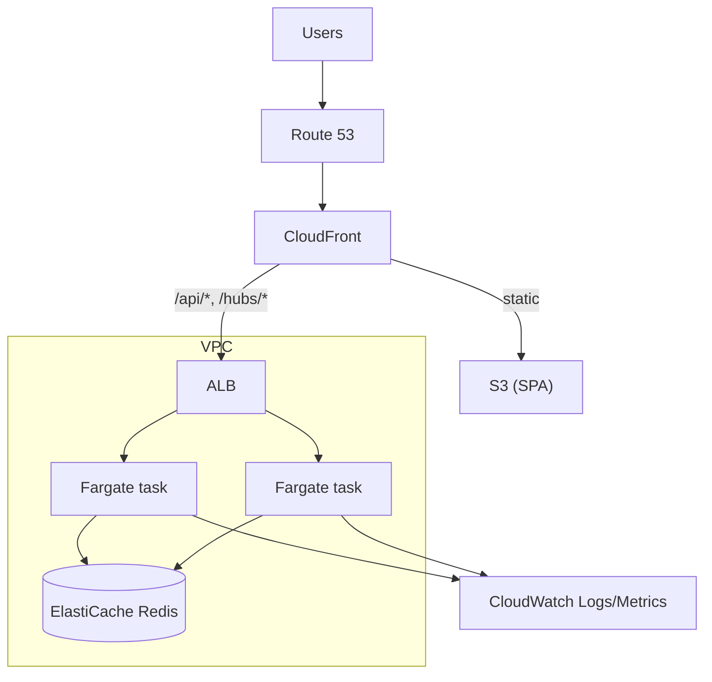

# 07 — Infrastructure

## 1. Local development and test (Docker)

`docker-compose.yml` defines three services:

| Service | Image | Notes |
|---------|-------|-------|
| `web` | multi-stage build → nginx serving the Vite build (dev profile: Vite dev server with hot reload) | Proxies `/api` and `/hubs` to `api`, including WebSocket upgrade |
| `api` | multi-stage .NET SDK → ASP.NET runtime image | Env: `Redis__ConnectionString`, `Cors__Origins`, token/password settings |
| `redis` | `redis:7` | Volume optional; data is disposable |

Commands: `docker compose up` (everything), `docker compose --profile dev up` (hot reload), `docker compose run --rm tests` (unit + integration). Integration tests use **Testcontainers** for Redis, so they do not need Compose.

## 2. AWS target

| Concern | Choice |
|---------|--------|
| Compute | ECS on Fargate, ≥ 2 tasks across AZs, autoscaling on CPU and connection count |
| Real-time | WebSocket-only SignalR; ALB idle timeout raised above the heartbeat interval; Redis backplane |
| State | ElastiCache for Redis (single node for demo, replicated for production) |
| Static site | S3 + CloudFront with SPA fallback to `index.html` |
| Edge routing | CloudFront behaviours: default → S3; `/api/*` and `/hubs/*` → ALB with caching disabled and WebSocket support |
| TLS and DNS | ACM certificates, Route 53 records |
| Secrets/config | SSM Parameter Store / Secrets Manager injected into tasks |
| Network | Private subnets for tasks and Redis; consider VPC endpoints versus NAT cost for a demo |
| Protection | AWS WAF rate rules in front of CloudFront (optional), security groups scoped tightly |

## 3. AWS CDK (C#)

Stacks in `infra/`:

| Stack | Contents |
|-------|----------|
| `NetworkStack` | VPC, subnets, security groups |
| `DataStack` | ElastiCache subnet group + replication group |
| `AppStack` | ECR repo, ECS cluster, Fargate service, ALB, autoscaling, log groups |
| `WebStack` | S3 bucket, CloudFront distribution, behaviours, certificate, DNS |
| `PipelineRoleStack` | GitHub OIDC role for CI deploys |

Stage configuration (`dev`, `prod`) comes from CDK context so the same code deploys both.

## 4. CI/CD (GitHub Actions)

1. **PR:** restore, build, unit tests, integration tests (Testcontainers), web lint/typecheck/tests, `cdk synth`, container image build.
2. **Main:** build and push images to ECR, `cdk diff`, deploy `dev` automatically.
3. **Release tag:** manual approval, deploy `prod`; sync SPA to S3 and invalidate CloudFront.
4. AWS access via GitHub **OIDC** (no long-lived keys). Dependabot for NuGet and npm. Optional container and dependency scanning.

## 5. Cost-conscious demo mode

For a portfolio deployment: one Fargate task, one small Redis node, no NAT (public subnets with restrictive security groups or VPC endpoints), CloudFront default certificate or a single custom domain. Document teardown (`cdk destroy`) so the demo can be switched off.

## 6. Operations

Dashboards: active sessions, connected clients, draws/sec, join failures, Redis memory. Alarms: unhealthy targets, 5xx rate, Redis memory/evictions, task restarts. Redis eviction policy `volatile-ttl`; since all keys carry TTLs, memory is bounded by session count.
