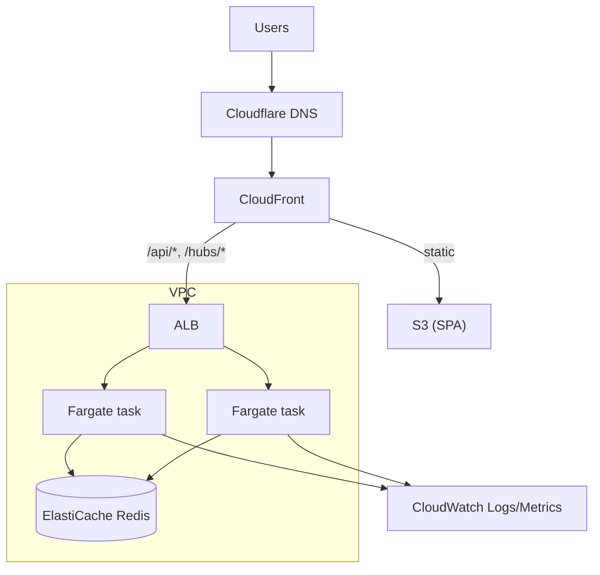

# 07 — Infrastructure

## 1. Local development and test (Docker)

`docker-compose.yml` defines three services:

| Service | Image | Notes |
|---------|-------|-------|
| `web` | multi-stage build: `node` → `nginx-unprivileged` serving the Vite build on port 8080 (planned dev profile: Vite dev server with hot reload) | SPA fallback to `index.html`; proxies `/api` and `/hubs` to `api`, including WebSocket upgrade. Host port 8080 |
| `api` | multi-stage build: .NET SDK → chiseled ASP.NET runtime (no shell, non-root) | Env: `Redis__ConnectionString`, `ForwardedHeaders__Enabled` (see below), later `Cors__Origins` and token/password settings. Host port 5080 for debugging |
| `valkey` | `valkey/valkey:8.1-alpine`: Redis-compatible (ADR 0011), the 8.x line ElastiCache offers. The API's settings keep the `Redis__` names, since they describe the protocol | No volume; data is disposable |

Commands: `docker compose up --build` (everything, then open http://localhost:8080). Planned: `docker compose --profile dev up` (hot reload) and `docker compose run --rm tests`, which will run the Playwright end-to-end suite against the running stack. The .NET and web unit/integration suites run directly (locally and in CI); integration tests use **Testcontainers** for Redis, so they do not need Compose.

CI builds both images on every PR, for **linux/amd64 and linux/arm64** (ADR 0011), so a broken Dockerfile is caught before merge. Neither needs emulation: the build stages run on the build machine's own architecture (a framework-dependent .NET publish and a Vite build are the same for every CPU), and the runtime stages only copy files onto the target architecture's base image. Image names are fully qualified (`docker.io/…`), which Podman requires.

**Client addresses behind a proxy.** The rate limits key on the caller's address (docs/05 §5), but behind nginx or Caddy every request comes from the proxy. With `ForwardedHeaders__Enabled=true` the API takes the address the proxy appended to `X-Forwarded-For` (only the last one, so a client can't prepend a made-up address), and only when the request comes from loopback or a private network, where the proxy runs. A header from anywhere else is ignored. In the Full profile the ALB plays the proxy's part, from inside the VPC.

Podman works in place of Docker: enable the user socket (`systemctl --user enable --now podman.socket`), set `DOCKER_HOST=unix://$XDG_RUNTIME_DIR/podman/podman.sock`, and use `podman compose` or `docker-compose`.

## 1a. Lean deployment (the live site, ADR 0011)

One small instance (AWS Lightsail; size to be verified, docs/10) runs `docker-compose.lean.yml`: `SITE_DOMAIN=syncbingo.com docker compose -f docker-compose.lean.yml up -d`. Without `SITE_DOMAIN` it serves `https://localhost` with Caddy's own local certificate, to try the production setup on a laptop.

| Service | Role |
|---------|------|
| `caddy` | The `caddy` target of `web/Dockerfile`: the same SPA build with `web/Caddyfile`. Let's Encrypt TLS for `syncbingo.com` and a redirect from `www` (DNS on Cloudflare, docs/10 §2a), HTTP/2 and HTTP/3, zstd/gzip, the same caching as nginx (hashed assets for a year, pages `no-cache`), proxies `/api` and `/hubs` (WebSockets) to `api`. Certificates live on a volume, so rebuilds don't run into Let's Encrypt's rate limits |
| `api` | The same image as everywhere else, with no published port: only Caddy reaches it. `ForwardedHeaders__Enabled=true` (Caddy replaces any client-sent `X-Forwarded-For` with the real address); `Web__PublicOrigin` from `SITE_DOMAIN` for join and display links |
| `valkey` | Append-only file (`everysec`) on a volume and no RDB snapshots, so live games survive API restarts, deploys and reboots. `maxmemory 256mb` with `noeviction`: every key has a TTL, and if memory still fills up, new writes fail (new games are refused) rather than a live game being evicted. 256 MB is a first guess until bytes per game are measured (docs/10) |

All three restart unless stopped, and logs are capped at 3 × 10 MB per service for a small disk.

**Deploys: the server pulls, nightly.**
- After a merge to master, and only when every check passes, CI's `publish` job pushes both images to GitHub's container registry: `ghcr.io/icemanjr/syncbingo-api` and `ghcr.io/icemanjr/syncbingo-web-caddy`. Each is tagged `latest` and `sha-<commit>` and labelled with its commit. Both are for amd64 and arm64.
- At 04:00 server time, a systemd timer (`deploy/syncbingo-update.timer`) runs `deploy/update.sh` in `/opt/syncbingo`. The script:
  1. pulls `latest` and reads the commit from its label;
  2. stops there if that commit is already running;
  3. otherwise fetches that commit's `docker-compose.lean.yml` and pulls both images by their `sha-` tag, so the API, the web app and the Compose settings always come from the same commit;
  4. runs `up -d`, which restarts only what changed. Players reconnect and resync from the snapshot (ADR 0002).
- If any step fails, nothing restarts. For an urgent fix, run the same script by hand over SSH.
- GitHub needs no key or access to the server, and the server needs no registry credentials: the packages are public, like the repository.

**Server setup** (once):
1. Install Docker with the Compose plugin.
2. Put `update.sh` in `/opt/syncbingo`, with an `.env` holding `SITE_DOMAIN=syncbingo.com`.
3. Copy the two units to `/etc/systemd/system/` and run `systemctl enable --now syncbingo-update.timer`.
4. Set the time zone with `timedatectl`.
5. Run `update.sh` once to start the site.
6. On GitHub, make each new package public (Package settings → Change visibility); new packages start private.

AWS Budgets alerts at $10 and $25.

## 2. AWS target (Full profile)

| Concern | Choice |
|---------|--------|
| Compute | ECS on Fargate, ≥ 2 tasks across AZs, autoscaling on CPU and connection count |
| Real-time | WebSocket-only SignalR; ALB idle timeout raised above the heartbeat interval; Redis backplane |
| State | ElastiCache for **Valkey** (single node for demo, replicated for production) |
| Static site | S3 + CloudFront with SPA fallback to `index.html` |
| Edge routing | CloudFront behaviours: default → S3; `/api/*` and `/hubs/*` → ALB with caching disabled and WebSocket support |
| TLS and DNS | ACM certificates; DNS records in Cloudflare, where `syncbingo.com` is registered (no Route 53 zone needed; docs/10 §2a) |
| Secrets/config | SSM Parameter Store / Secrets Manager injected into tasks |
| Network | Private subnets for tasks and Redis; consider VPC endpoints versus NAT cost for a demo |
| Protection | Security groups scoped tightly. Edge rate rules (AWS WAF in front of CloudFront, or Cloudflare) only with **very high per-IP thresholds**, or none: a whole event of up to 100 people shares one WiFi address, and a busy game is thousands of requests from that address in a few minutes. The API's own limits (docs/05 §5) are keyed by player token where it matters |

## 3. AWS CDK (C#)

Stacks in `infra/`:

| Stack | Contents |
|-------|----------|
| `NetworkStack` | VPC, subnets, security groups |
| `DataStack` | ElastiCache subnet group + replication group |
| `AppStack` | ECR repo, ECS cluster, Fargate service, ALB, autoscaling, log groups |
| `WebStack` | S3 bucket, CloudFront distribution, behaviours, certificate, DNS |
| `PipelineRoleStack` | GitHub OIDC role for CI deploys |

Stage configuration (`dev`, `prod`) comes from CDK context so the same code deploys both. A second context flag, `profile=lean|full` (ADR 0011), selects the Lean instance or the full set of stacks; `cdk synth` runs for both in CI.

## 4. CI/CD (GitHub Actions)

1. **PR:** restore, build, unit tests, integration tests (Testcontainers), web lint/typecheck/tests, `cdk synth`, container image build.
2. **Main:** build and push images to ECR, `cdk diff`, deploy `dev` automatically.
3. **Release tag:** manual approval, deploy `prod`; sync SPA to S3 and invalidate CloudFront.
4. AWS access via GitHub **OIDC** (no long-lived keys). Dependabot for NuGet and npm. Optional container and dependency scanning.

## 5. Cost

See [10 — Cost and Hosting](10-cost-and-hosting.md): the Lean, Middle and Full tiers, cost drivers, the free-credit strategy, budgets and teardown. Fargate tasks use **arm64** (Graviton) images; ElastiCache uses **Valkey**.

## 6. Operations

Dashboards: active sessions, connected clients, draws/sec, join failures, Redis memory. Alarms: unhealthy targets, 5xx rate, Redis memory/evictions, task restarts. Redis eviction policy `volatile-ttl`; since all keys carry TTLs, memory is bounded by session count.
