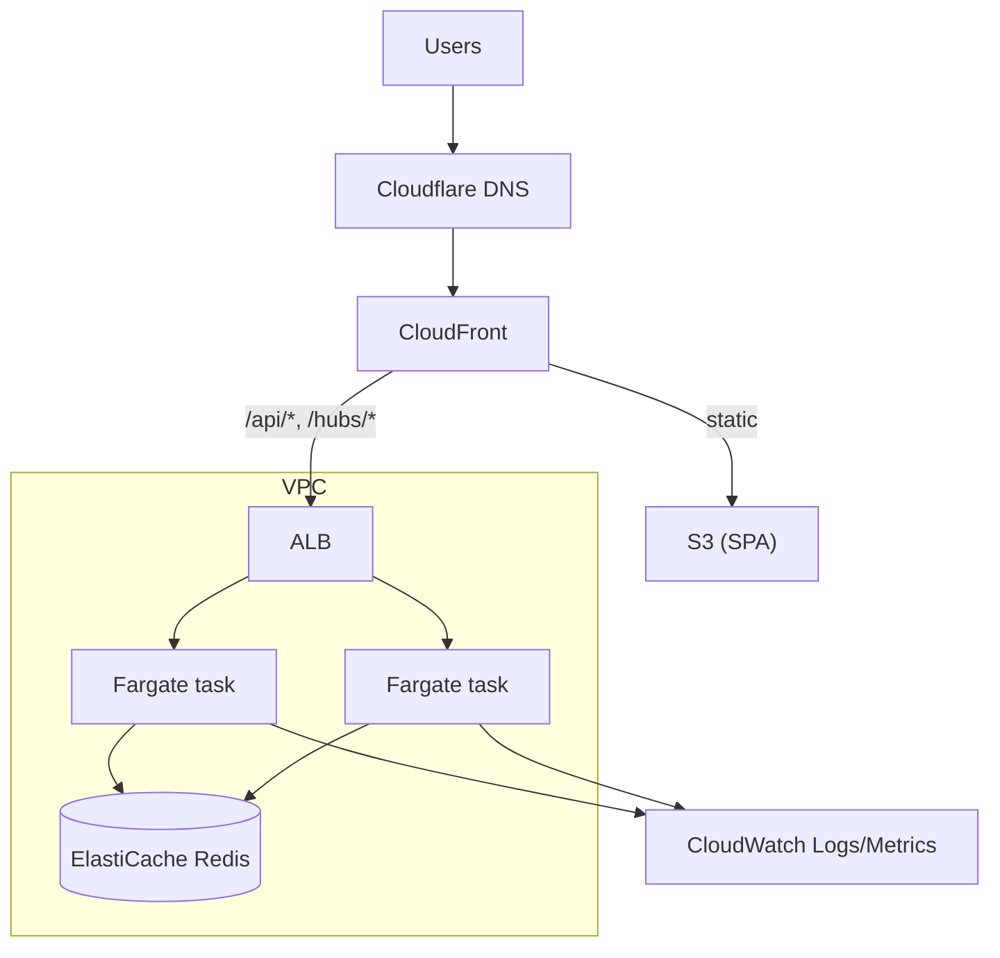

# 07 — Infrastructure

## 1. Local development and test (Docker)

`docker-compose.yml` defines three services:

| Service | Image | Notes |
|---------|-------|-------|
| `web` | multi-stage build: `node` → `nginx-unprivileged` serving the Vite build on port 8080 (planned dev profile: Vite dev server with hot reload) | SPA fallback to `index.html`; proxies `/api` and `/hubs` to `api`, including WebSocket upgrade. Host port 8080 |
| `api` | multi-stage build: .NET SDK → chiseled ASP.NET runtime (no shell, non-root) | Env: `Redis__ConnectionString`, later `Cors__Origins` and token/password settings. Host port 5080 for debugging |
| `redis` | `redis:7.4-alpine` today; switching to **Valkey** (ADR 0011, roadmap Phase 1b) | No volume; data is disposable |

Commands: `docker compose up --build` (everything, then open http://localhost:8080). Planned: `docker compose --profile dev up` (hot reload) and `docker compose run --rm tests`, which will run the Playwright end-to-end suite against the running stack. The .NET and web unit/integration suites run directly (locally and in CI); integration tests use **Testcontainers** for Redis, so they do not need Compose.

CI builds both images on every PR so a broken Dockerfile is caught before merge.

Podman works in place of Docker: enable the user socket (`systemctl --user enable --now podman.socket`), set `DOCKER_HOST=unix://$XDG_RUNTIME_DIR/podman/podman.sock`, and use `podman compose` or `docker-compose`.

## 1a. Lean deployment (the live site, ADR 0011)

One small instance (AWS Lightsail; size to be verified, docs/10) runs a production Compose file:

| Service | Role |
|---------|------|
| `caddy` | Let's Encrypt TLS for `syncbingo.com` (DNS on Cloudflare, docs/10 §2a), serves the SPA build, proxies `/api` and `/hubs` (WebSockets) to `api` |
| `api` | The same image as everywhere else |
| `valkey` | Append-only persistence on a volume, so live games survive API restarts, deploys and reboots |

Deploys: CI builds and pushes the images, then the instance pulls and restarts `api` off-hours; clients reconnect and resync. AWS Budgets alerts at $10 and $25.

## 2. AWS target (Full profile)

| Concern | Choice |
|---------|--------|
| Compute | ECS on Fargate, ≥ 2 tasks across AZs, autoscaling on CPU and connection count |
| Real-time | WebSocket-only SignalR; ALB idle timeout raised above the heartbeat interval; Redis backplane |
| State | ElastiCache for **Valkey** (single node for demo, replicated for production) |
| Static site | S3 + CloudFront with SPA fallback to `index.html` |
| Edge routing | CloudFront behaviours: default → S3; `/api/*` and `/hubs/*` → ALB with caching disabled and WebSocket support |
| TLS and DNS | ACM certificates; DNS records in Cloudflare, where `syncbingo.com` is registered (no Route 53 zone needed; docs/10 §2a) |
| Secrets/config | SSM Parameter Store / Secrets Manager injected into tasks |
| Network | Private subnets for tasks and Redis; consider VPC endpoints versus NAT cost for a demo |
| Protection | AWS WAF rate rules in front of CloudFront (optional), security groups scoped tightly |

## 3. AWS CDK (C#)

Stacks in `infra/`:

| Stack | Contents |
|-------|----------|
| `NetworkStack` | VPC, subnets, security groups |
| `DataStack` | ElastiCache subnet group + replication group |
| `AppStack` | ECR repo, ECS cluster, Fargate service, ALB, autoscaling, log groups |
| `WebStack` | S3 bucket, CloudFront distribution, behaviours, certificate, DNS |
| `PipelineRoleStack` | GitHub OIDC role for CI deploys |

Stage configuration (`dev`, `prod`) comes from CDK context so the same code deploys both. A second context flag, `profile=lean|full` (ADR 0011), selects the Lean instance or the full set of stacks; `cdk synth` runs for both in CI.

## 4. CI/CD (GitHub Actions)

1. **PR:** restore, build, unit tests, integration tests (Testcontainers), web lint/typecheck/tests, `cdk synth`, container image build.
2. **Main:** build and push images to ECR, `cdk diff`, deploy `dev` automatically.
3. **Release tag:** manual approval, deploy `prod`; sync SPA to S3 and invalidate CloudFront.
4. AWS access via GitHub **OIDC** (no long-lived keys). Dependabot for NuGet and npm. Optional container and dependency scanning.

## 5. Cost

See [10 — Cost and Hosting](10-cost-and-hosting.md): the Lean, Middle and Full tiers, cost drivers, the free-credit strategy, budgets and teardown. Fargate tasks use **arm64** (Graviton) images; ElastiCache uses **Valkey**.

## 6. Operations

Dashboards: active sessions, connected clients, draws/sec, join failures, Redis memory. Alarms: unhealthy targets, 5xx rate, Redis memory/evictions, task restarts. Redis eviction policy `volatile-ttl`; since all keys carry TTLs, memory is bounded by session count.
